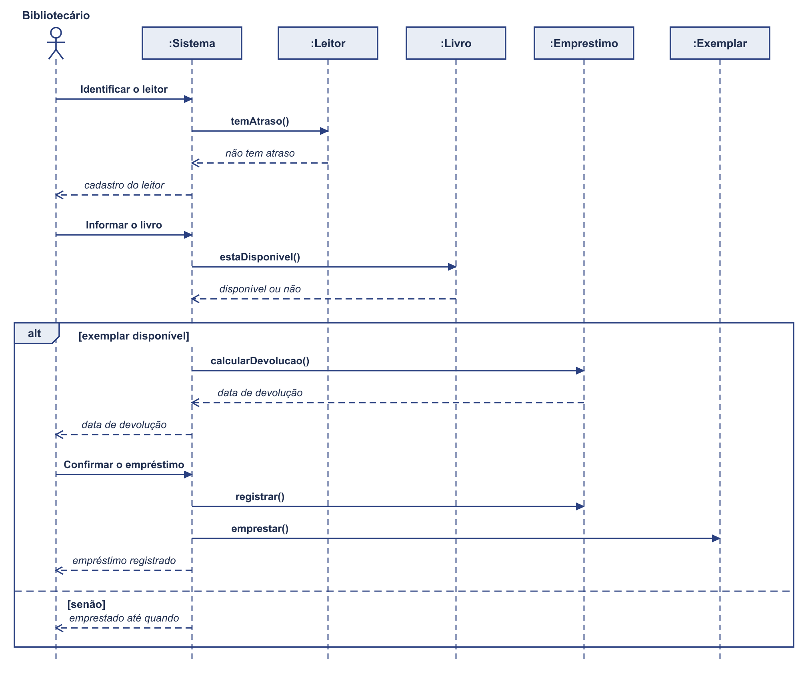

# 4.2.4 Modelagem de Sequência

## Do fluxo às mensagens

O diagrama de sequência conta um cenário do caso de uso como uma conversa. Ele mostra quem pede o quê a quem, em que ordem, e o que volta. O cenário é o fluxo principal de Registrar empréstimo, da 4.2.2. Os participantes são as classes da 4.2.3.

Três regras de tradução. Cada passo do bibliotecário vira uma mensagem dele para o Sistema, com o nome da ação da 4.2.5. Cada passo do sistema vira uma mensagem do Sistema para a classe que tem a operação, com o nome da operação e os parênteses. E cada resposta volta numa seta tracejada, para quem perguntou.

A linha de vida `:Sistema` é a raia do Sistema da 4.2.5. Ela representa a tela e o que coordena as classes. Não é uma classe da 4.2.3, porque interface não entra lá. Ela ganha forma na 4.2.7 e na 3.3.

| No fluxo da 4.2.2 | Vira a mensagem | De quem para quem | Por quê |
|---|---|---|---|
| passo 1: o bibliotecário identifica o leitor | **Identificar o leitor** | Bibliotecário → :Sistema | passo do ator é mensagem dele para o Sistema. O nome é o da ação da 4.2.5, sem parênteses |
| passo 2: o sistema mostra o cadastro e confirma que não há atraso | **temAtraso()**, o retorno _não tem atraso_ e o retorno _cadastro do leitor_ | :Sistema → :Leitor, e a resposta volta até o Bibliotecário | quem sabe se há atraso é o leitor. A pergunta vai para ele, e a resposta volta tracejada |
| passo 3: o bibliotecário informa o livro | **Informar o livro** | Bibliotecário → :Sistema | passo do ator |
| passo 4: o sistema confirma que o exemplar está disponível | **estaDisponivel()** e o retorno _disponível ou não_ | :Sistema → :Livro | a operação mora em `Livro`, que lê a situação dos seus exemplares. A resposta decide o fragmento |
| passo 5: o sistema calcula a data de devolução (RF07) | **calcularDevolucao()** e o retorno _data de devolução_, que segue até o balcão | :Sistema → :Emprestimo, e a resposta volta até o Bibliotecário | o requisito que virou operação na 4.2.3 e ação na 4.2.5 vira mensagem aqui |
| passo 6: o bibliotecário confirma o empréstimo | **Confirmar o empréstimo** | Bibliotecário → :Sistema | passo do ator |
| passo 7: o sistema registra e marca o exemplar como emprestado | **registrar()** e **emprestar()**, e o retorno _empréstimo registrado_ | :Sistema → :Emprestimo e :Sistema → :Exemplar | um passo com duas coisas vira duas mensagens. A segunda é operação da 4.2.3. A primeira ainda não é |
| E2: o exemplar está emprestado, o sistema informa até quando | fragmento **alt** com duas guardas: [exemplar disponível] cobre os passos 5 a 7, e [senão] traz o retorno _emprestado até quando_ | :Sistema → Bibliotecário | o alt diz que só um dos dois andares acontece. É a decisão _exemplar disponível?_ da 4.2.5 |
| A1 e E1: leitor não encontrado, leitor com atraso | ficam fora do desenho | nenhuma mensagem | já estão na Figura 4. O diagrama de sequência conta um cenário, e com todos os desvios ele vira um labirinto |

## Diagrama de sequência

**Figura 5 – Diagrama de sequência de Registrar empréstimo**

Fonte: Autoria própria (2026).

A Figura 5 tem seis linhas de vida. A da esquerda é o **Bibliotecário**, o ator, do lado de fora. A segunda é o **:Sistema**. As outras quatro são objetos das classes da 4.2.3: `:Leitor`, `:Livro`, `:Emprestimo` e `:Exemplar`. Os dois-pontos antes do nome dizem "um objeto desta classe".

O tempo corre de cima para baixo. As **mensagens** são as setas cheias, e são oito. Três saem do Bibliotecário e levam o nome das ações da 4.2.5. Cinco saem do Sistema, levam o nome de uma operação e chegam na classe que a executa.

Os **retornos** são as setas tracejadas, e são sete. Cada um leva uma resposta de volta para quem perguntou. `registrar()` e `emprestar()` não têm retorno desenhado, porque não devolvem valor. Na 4.2.3, `emprestar()` é `void`.

O quadro com a aba **alt** é o fragmento da exceção E2. Ele tem dois andares, separados por uma linha tracejada, e só um deles acontece. Com [exemplar disponível], seguem os passos 5 a 7. Com [senão], o Sistema informa até quando o exemplar está emprestado, e nada é registrado.

`Usuario` e `Bibliotecario` não têm linha de vida. Nenhuma mensagem deste cenário chega neles. O bibliotecário aparece como ator, e a classe geral não executa nada aqui. Linha de vida sem mensagem não entra.

A linha de `:Emprestimo` começa no alto, como as outras, embora o empréstimo só passe a valer no passo 7. É uma simplificação. A criação de objeto tem notação própria, que fica fora do teto.

## Rastreabilidade com a 4.2.3

| Mensagem | Chega em | Operação na 4.2.3 | Passo da 4.2.2 |
|---|---|---|---|
| temAtraso() | :Leitor | `Leitor`, + temAtraso(): boolean | passo 2 |
| estaDisponivel() | :Livro | `Livro`, + estaDisponivel(): boolean | passo 4 |
| calcularDevolucao() | :Emprestimo | `Emprestimo`, + calcularDevolucao(): Data | passo 5 |
| registrar() | :Emprestimo | ❓ não existe na 4.2.3 | passo 7, primeira parte |
| emprestar() | :Exemplar | `Exemplar`, + emprestar(): void | passo 7, segunda parte |
| Identificar o leitor, Informar o livro, Confirmar o empréstimo | :Sistema | nenhuma: são as três ações da raia do Bibliotecário na 4.2.5 | passos 1, 3 e 6 |

**Toda mensagem com parênteses chega em quem tem a operação.** Quatro das cinco mensagens do Sistema são operações da classe em que chegam, com o mesmo nome da 4.2.3. A quinta é o achado desta seção.

**Todo passo tem mensagem.** Os sete passos do fluxo principal estão no desenho, na ordem, e a E2 está no fragmento. O A1 e a E1 ficaram de fora de propósito, e a tabela de tradução diz por quê.

**O que o desenho mudou.** O passo 7 diz "registra o empréstimo e marca o exemplar". A 4.2.3 tinha operação para a segunda metade, `emprestar()`, e nenhuma para a primeira. Desenhar a seta obrigou a escrever um nome nela, e o nome não existia.

❓ Para a próxima revisão da 4.2.3: `Emprestimo` ganha a operação `registrar()`. Mensagem sem operação é operação faltando na classe, e o conserto é lá.
